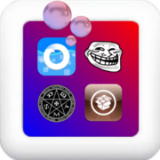

local image:

2nd local:

online image:

last img tset:

# How does this work?

Slippery Board draws your own icons on the home screen. You choose the themes, icons and options here, then tap **Apply**.

## Themes

Install icon themes with your package manager, or import a **zip** or a **.deb** with the button at the top right of the main page. Tap a theme to turn it on.

When several active themes have an icon for the same app, the one higher up wins. Tap **Edit** to change the order.

## Apply

Nothing changes on your home screen until you tap **Apply**. It draws the icons of your active themes and your custom icons.

If an icon still looks wrong afterwards, use **Rebuild icons** in Settings.

## Custom icons

The photo button at the top left lets you pick an image for a single app, from Photos or Files. A custom icon wins over every theme.

## Icon shape

In Settings, the **icon shape** is one of:

- iOS shape
- circle
- rounded square
- square
- teardrop
- the shape of a theme

| Icon shape | What you get |
|---|---|
| iOS shape | The iOS icon shape on the marked icons. The background is drawn by the home screen |
| Circle, rounded square, square, teardrop | That shape, drawn into the marked icons and the apps without a theme icon, with the background inside it |
| Theme mask | The mask a theme brings along (AppIconMask) |
| Theme's own shape | Nothing changes, and no background |

It is used for the apps your themes have no icon for, and for the icons and themes you **marked "iOS shape"**: swipe right on an icon in the Custom icons screen, or on an active theme. The other theme icons keep their own shape.

## Icon background

In Settings, light and dark mode each get a background: a color, a gradient or an image. It goes behind the marked icons and shows where their icon is transparent.

> It does not work with the icon shape "Theme's own shape".

## Icon effects

Some themes bring an underlay and an overlay (Anemone effects). Turn on **Icon effects** in Settings to draw them into your icons.

## Troubleshooting

If something doesn't look right, try **Rebuild icons** first. **Diagnostics** in Settings shows what happened and can be copied to share.
